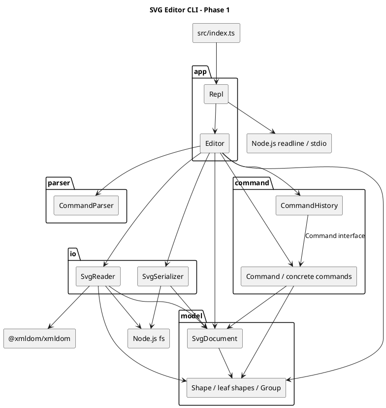

# SVG 编辑器 CLI：架构与实现说明

本文对应 `phase_cli_1.md` 中 Lab1 Phase 1 的文档要求，基于当前源码与 2026-10-27 的实际核验编写。

阶段范围为 TypeScript 面向对象 CLI，内置 `rect`、`circle`、`ellipse`、`line`、`text`、`g` 六种图形，支持文件读写、结构展示、编辑及撤销重做。`box` 与插件注册属于后续阶段，不作为本阶段已实现能力。

> 说明：本文是对现有实现的架构整理，不声称是开发前已确定的原始方案。过程记录只记录本次可核实的工作，不虚构历史对话、提交记录或已完成的修复。

## 一、架构方案

### 1. 模块划分

当前采用五个源码模块，由入口负责启动：

```text
src/
  index.ts
  app/
    Repl.ts
    Editor.ts
  parser/
    CommandParser.ts
  model/
    Shape.ts
    Rect.ts / Circle.ts / Ellipse.ts / Line.ts / TextShape.ts
    Group.ts
    SvgDocument.ts
  command/
    Command.ts
    CommandHistory.ts
    CreateCommand.ts / DeleteCommand.ts / MoveCommand.ts / ScaleCommand.ts
    SetCommand.ts / GroupCommand.ts / UngroupCommand.ts / AddtoCommand.ts
    FrontCommand.ts / BackCommand.ts
  io/
    SvgReader.ts
    SvgSerializer.ts
doc/
  README.md
```

| 模块 | 职责 | 关键类 |
|---|---|---|
| 入口 `index.ts` | 创建 REPL 并启动，不承载图形业务 | `Repl` 的装配 |
| `app` | 终端交互与应用编排；检查命令参数、定位对象、创建命令、调用历史与 IO | `Repl`、`Editor` |
| `parser` | 将命令行拆为参数，处理双引号、空行、整行注释及末尾 `in` 子句 | `CommandParser` |
| `model` | 封装几何数据、属性与组合树，维护画布、父子关系和 id 索引 | `Shape`、各图形类、`Group`、`SvgDocument` |
| `command` | 将一条编辑操作封装为对象，保存撤销信息并管理 undo/redo | `Command`、十个具体命令、`CommandHistory` |
| `io` | 文件读写、XML 解析及领域对象构建，隔离文件系统依赖 | `SvgReader`、`SvgSerializer` |

以下 PlantUML 组件图描述当前模块依赖，箭头表示调用或依赖方向，可由支持 PlantUML 的工具渲染：



当前分层不是完整的依赖倒置架构：`Editor` 直接创建具体命令、具体图形与 IO 类；`model` 也承担 SVG 文本和展示文本生成。这里如实保留这些边界，避免把未来目标写成现状。

### 2. 设计模式的选择与落地

#### 2.1 Command：编辑命令与撤销重做

选择原因：每条编辑命令应是一个 undo 单元；调用者不应分别维护不同操作的恢复逻辑。

| 角色 | 实现 |
|---|---|
| 命令契约 | `command/Command.ts`，定义 `execute(): string` 和 `undo(): string` |
| 具体命令 | `CreateCommand`、`MoveCommand` 等，每个类负责一次编辑及其逆操作 |
| 调用者及历史管理 | `CommandHistory`，维护 undo 栈、redo 栈与 IO 禁止标记 |
| 接收者 | `Shape`、`Group`、`SvgDocument` |
| 命令构建与提交 | `Editor` 的各 `handle*` 方法 |

调用链为：

```text
Repl -> Editor.handleLine -> CommandParser
     -> Editor 校验并定位对象
     -> 创建具体 Command
     -> CommandHistory.execute
     -> Command.execute -> model
```

撤销信息按操作选择：

- `MoveCommand` 保存位移增量，通过负增量撤销。
- `ScaleCommand` 保存图形及子孙的属性快照，再恢复原值，避免单纯除法带来的恢复误差。
- `DeleteCommand`、`AddtoCommand`、`FrontCommand`、`BackCommand` 保存原父节点和/或同级位置。
- `GroupCommand` 保存每个被收编图形的来源，一次 undo 恢复整组。
- `UngroupCommand` 保存容器位置与子节点列表，撤销时重建关系。
- `SetCommand` 保存旧属性值，但目前不能正确撤销“原本不存在的属性”，见质量保证部分。

`redo` 复用命令的 `execute()`；新编辑清空 redo 栈。显示命令不进入历史。成功 `init/read` 会清空历史并阻止撤销；`save` 和画布尺寸修改设置禁止标记，下一次编辑解除标记。失败保存的处理目前存在状态原子性问题。

#### 2.2 Composite：容器与叶子统一操作

`Shape` 是抽象基类，规定 `move`、`scale`、属性操作、展示和序列化行为。各叶子类封装几何数据并实现这些方法。

`Group` 同样继承 `Shape`，维护只读暴露的子节点列表；`move/scale` 递归调用子节点的同名方法。编辑命令无需按具体图形标签分派几何操作。删除容器时，`SvgDocument` 同时注销子孙 id，撤销时恢复整棵子树。

本阶段移动与缩放容器直接修改子孙坐标，不新增 `transform` 属性。普通 `g` 的 `set fill/stroke/stroke-width` 修改容器自身属性，SVG 渲染时遵循继承规则，不等同于未来 `box` 的插件传播语义。

#### 2.3 快照恢复思想与集中构建

`ScaleCommand` 使用局部快照恢复，具有 Memento 的思想，但没有独立、不透明的 Memento 类型，不将其描述为完整 Memento 模式。

`Editor.createShape` 集中构建六种图形，属于简单工厂式方法；目前不是独立工厂模块，也不是插件注册机制。`SvgReader.parseElement` 另有按标签构建对象的逻辑，两处未共享注册表，是待重构项。

#### 2.4 按名字分派的约束

需求允许命令分发与图形工厂两处按名字分派，并要求标注待重构：

| 位置 | 现状 | 后续处理 |
|---|---|---|
| `Editor.handleLine` | `switch(cmd)` 分发命令 | 替换为命令处理器注册表 |
| `Editor.createShape` | `switch(type)` 创建图形 | 抽出共享图形工厂/提供者注册表 |
| `SvgReader.parseElement` | 额外的 `switch(tag)` 构建读入对象 | 违反“两处”限制，合并进共享图形工厂 |

图形类内还有按属性名的 `switch(name)`，它们不是按图形标签选择行为；若课程对“按名字分派”采用更严格解释，也应改成各类封装的属性访问映射。不能以已有多态为由忽略额外的读入分派。

### 3. 依赖方向规则

以下规则描述本阶段实际采用的模块边界，而非尚未实现的理想架构：

| 模块 | 允许依赖 | 禁止依赖 | 理由 |
|---|---|---|---|
| 入口 | `app` | 直接处理领域与文件业务 | 启动逻辑保持最小 |
| `app` | `parser`、`command`、`model`、`io`；REPL 可依赖终端 API | 下层反向调用 `app` | 应用层负责组合用例与适配终端 |
| `parser` | 基础语言能力 | `app`、`model`、`command`、`io`、文件系统 | 解析应可独立测试 |
| `command` | `model`、模块内 `Command` 契约 | `app`、`parser`、`io`、终端与文件系统 | 编辑及其撤销不应依赖输入输出渠道 |
| `model` | 模块内类型、基础集合 | `app`、`parser`、`command`、`io`、Node.js IO、XML 库 | 核心图形行为不依赖外部适配器 |
| `io` | `model`、文件系统、XML 库 | `app`、`parser`、`command` | 读写转换不负责调度编辑历史 |

`Shape` 与 `Group` 相互引用属于 `model` 内部关系，不是模块反向依赖。后续可将仅作类型用途的导入改为 `import type`，明确类型关系与运行时关系的区别。

当前没有发现跨模块违反上述规则的 import。不过 `Editor` 对具体实现的直接依赖、模型里的展示和序列化职责会提高变化成本，是架构改进项，不应混淆为已完成的接口隔离。

### 4. 变化点假设

| 可能变化 | 已留出的能力 | 当前决定与代价 |
|---|---|---|
| 新增图形及复合图形 `box` | `Shape` 多态与 `Group` 子树组合 | 尚无 `ShapeProvider`；新增类型仍需改 CLI 工厂与读入器。后续统一注册，不能承诺当前“内核零改动” |
| 新增编辑命令 | `Command` 契约与统一历史栈 | 编辑行为可独立成类，但仍需更新 `Editor` 分发和帮助文本；后续引入处理器注册 |
| GUI、agent 等输入渠道 | `Editor.handleLine` 不直接读终端，REPL 独立 | 可先复用应用入口；结构化 API 与可注入应用服务尚未提供 |
| SVG 格式支持扩大 | 文件系统访问集中在 `io` | 序列化仍由模型生成；若支持其他格式，考虑提取编解码接口。暂不引入完整 Visitor，避免超出六种类型的阶段范围 |
| 撤销策略与大文档性能 | 历史管理独立，具体命令保存局部状态 | 暂不提供持久化历史、栈容量限制或批处理；规模增大时评估快照占用与事务边界 |
| 参数与错误规范 | 解析与编辑逻辑分离，常规错误使用 `error:` | 缺少统一数值校验和结构化错误；优先补验证与失败原子性，不先扩展命令语法 |
| 任意外部 SVG 导入 | XML 解析集中在 `SvgReader` | 当前仅保留支持的元素与属性，不能保证任意 SVG 无损读写；变换、样式与未知元素应先明确支持策略 |

## 二、过程记录

### 1. 可追溯范围

当前工作区没有提供可追溯的历史 AI 对话或 `.git` 目录。本节仅记录本次文档整理及核验，不把根据源码推断的设计理由伪装成过去发生的讨论。

### 2. 本次关键步骤与确认结果

| 步骤 | 讨论或检查重点 | 证据与处理 |
|---|---|---|
| 需求确认 | 文档应放在哪里、覆盖哪些内容 | 阅读 `phase_cli_1.md`，确定为 `doc/README.md`，组织为四个必需章节 |
| 架构还原 | 是否真的采用 Command 与 Composite | 检查命令接口、历史栈、具体命令及 `Shape/Group`；将实际角色和调用链写入方案 |
| 边界校正 | 是否已有插件机制、统一工厂与独立序列化策略 | 发现目前没有注册接口，读入与创建各自分派，模型生成 SVG；删除无法由源码支持的成熟架构表述 |
| 依赖检查 | 是否存在底层反向依赖应用层 | 检索全部 import，确认跨模块方向符合本文规则；额外标签分派单独记录为范式待处理项 |
| 类型验证 | 本地工具是否能运行 | `npx tsc --noEmit` 因命令入口不可用失败；改用本地编译器直接执行，类型检查通过 |
| 功能核验 | 核心场景是否可用、撤销是否真正恢复状态 | 通过内存中 Node.js 断言执行器运行场景，核心抽样通过，同时确认三个边界缺陷 |
| 文档收敛 | 是否可声称功能完全达标 | 区分通过项、实测缺陷、静态风险与未验证项；本次只生成文档，不修改业务实现 |

这里的“纠正”指文档结论的纠正，不意味着已修复代码。后续真实修复应记录复现输入、修改文件、验证结果和对应提交，而不是事后补写不存在的开发过程。

### 3. 修订记录

| 日期 | 修订 | 状态 |
|---|---|---|
| 2026-10-27 | 根据现有五模块结构整理架构方案与依赖图 | 已写入 |
| 2026-10-27 | 将额外 SVG 标签分派、具体类耦合与模型展示职责列为待改进项 | 已写入，代码未改 |
| 2026-10-27 | 加入实际类型检查、功能抽样和已知问题，避免“全部达标”的无依据结论 | 已写入，缺陷待修复 |

## 三、一致性自查

### 1. 模块划分是否一致

实际 `src/` 包含 `app`、`parser`、`model`、`command`、`io`，与本文方案一致，入口为 `src/index.ts`。类与接口分别置于同名文件；图形几何字段为私有字段，行为由图形对象负责，不是公共数据袋加自由函数。

由于本文为事后整理，不能据此证明实际目录与未知的开发前方案一致。当前未发现目录层面的偏差；职责层面仍需关注 `Editor` 集中编排与模型承担文本输出的耦合，已记入修订记录。

### 2. 依赖方向是否被违反

本次检索 `src` 全部 import，并抽样追踪以下依赖：

| 样本 | 实际依赖 | 结论 |
|---|---|---|
| `app/Repl.ts` | `readline`、`Editor` | 符合终端适配与应用编排方向 |
| `app/Editor.ts` | 模型、具体命令、历史、解析器、读写器 | 符合本阶段允许方向，但未做到依赖倒置 |
| `command/MoveCommand.ts` | `Command`、`Shape` | 符合编辑命令依赖领域模型 |
| `command/DeleteCommand.ts` | `Command`、`Shape`、`Group`、`SvgDocument` | 符合领域操作方向 |
| `io/SvgReader.ts` | `fs`、XML 库、模型类 | 符合外部格式到领域模型的适配 |
| `model/Shape.ts`、`model/Group.ts` | 模块内部类型 | 无跨模块反向依赖 |
| `parser/CommandParser.ts` | 无 import | 解析独立 |

结论：未发现违反本文跨模块规则的依赖；但“仅两处按名字分派”存在额外标签分派，尚未满足。依赖方向合规不等于所有架构与范式要求都已达标。

## 四、质量保证手段

### 1. 已执行的验证

类型检查命令：

```powershell
node node_modules/typescript/bin/tsc --noEmit
```

结果：通过，无诊断输出。`tsconfig.json` 启用 `strict`、文件名大小写一致性等检查。此结果证明当前源码通过配置的静态检查，不证明运行时输入合法。

功能核验通过 `node -r ts-node/register` 执行内存中的 Node.js `assert/strict` 断言，没有向项目加入临时测试文件或测试框架。

| 已核验场景 | 结果 |
|---|---|
| 未建立文档时执行 `tree`；整行注释 | 返回约定错误；注释被忽略 |
| 六种内置类型创建；嵌套 `g` 与 `in` | 创建成功，父子关系与带空格文字正确 |
| 容器移动及 undo/redo | 子图形随行，undo 恢复原树内容，redo 再次应用 |
| 容器缩放及 undo | 对比缩放前后 tree，undo 恢复原值 |
| 修改已存在的文本内容及 undo | 恢复原文本 |
| 删除嵌套容器及 undo | 子孙暂不可定位，撤销后恢复原父级 |
| `group` 的 undo/redo、`addto` 的 undo | 抽样关系与状态恢复正确 |
| `front/back` 的 undo | 恢复原同级顺序 |
| 嵌套容器 `ungroup` 及 undo | 恢复原结构；根级容器解散被拒绝 |
| 重复 id、缺失 id、零缩放、未知属性、祖先与后代分组、`box` | 返回错误，抽样中的 tree 不变 |
| undo 后新编辑 | redo 栈清空 |
| 修改画布尺寸后的 undo | 返回 IO 后禁止撤销错误 |
| `read other.svg` | 为无 id 矩形分配 `rect1` 并警告，尺寸为 400×300 |

这些属于核心路径抽样，不是完整测试覆盖率报告。仓库当前没有 `test` 脚本、持久化测试用例或 CI，不能声称已建立自动回归保障。

### 2. 实测确认的待修复问题

#### Q1：撤销新增属性没有恢复“属性不存在”

复现：

```text
init
create rect r 0 0 10 10
set r fill red
undo
show r
```

实测 `show` 仍包含 `fill=red`。原因是 `SetCommand.undo()` 仅在旧值非 `undefined` 时恢复，而模型没有删除属性的接口。应增加属性移除能力，区分“未设置”与空字符串，并补新增公共属性的撤销测试。

#### Q2：非法数值可以进入模型

复现：

```text
init
create rect r 0 0 10 10
scale r invalid
```

实测返回 `scaled by NaN`。`Number()` 转换后未统一验证有限数，`NaN <= 0` 为假，绕过正数检查。应在变更前检查所有几何输入和画布尺寸，明确尺寸约束，并验证错误不会改变树与历史。

#### Q3：失败保存改变应用状态

复现，目标目录须不存在：

```text
init
create rect r 0 0 10 10
save __nonexistent_doc_check__/a.svg
undo
```

实测保存报错后，undo 返回 `error: undo not allowed after io command`。`Editor.handleSave()` 在写入成功前就更新路径并设置历史禁止标记。应将这些状态变更推迟到保存成功之后，满足“失败不改变任何状态”。

### 3. 静态检查发现的风险

以下来自代码阅读，未在本次执行中完整复现，不与实测结果混写：

| 风险 | 代码依据 | 建议 |
|---|---|---|
| 移入自己或后代可能形成循环 | `handleAddto`、`AddtoCommand` 没有祖先关系检查 | 在任何摘取操作前拒绝自包含及祖先移入后代 |
| 多个自动 id 冲突可能导致不终止 | `SvgReader.autoId` 的循环使用固定初始 `count + 1`，未逐次递增 | 使用可变候选序号，测试已存在 `rect1/rect2` 的文件 |
| 外部重复 id 未被拒绝 | 读入器用 Set 收集 id，索引用 Map 注册时可覆盖 | 读入前验证唯一性，失败不替换当前文档 |
| 分组顺序及重复参数需进一步核验 | `GroupCommand` 按输入 id 顺序添加，未去重 | 对照“保持相对顺序”约定，测试逆序参数与重复 id |
| XML 属性缺少统一转义 | id 和公共属性直接拼接到 SVG 文本 | 对属性值转义，测试引号、`&`、`<` 等字符 |
| 非法 XML 与未知节点处理不完整 | 解析异常未统一转换为错误，未知标签返回 null | 明确严格解析、警告或拒绝策略 |
| 外部 SVG 可能有损 | 未保留 `transform`、`style`、`data-kind` 等 | 明确支持子集，不能承诺任意 SVG 无损 round-trip |
| 引号与参数语法验证不足 | 解析器接受未闭合双引号，部分处理器仅检查最少参数 | 补充语法错误反馈与失败原子性测试 |

### 4. 提交前应补齐的验证

- 持久化命令与模型测试，提供 `npm test` 并接入 CI。
- 每个编辑命令执行“前状态 → 执行 → undo → 原状态 → redo → 执行后状态”的完整断言；除 tree 外，还应比较 SVG、id 可定位性与父子顺序。
- 对所有命令补参数数量、非有限数、缺失对象、循环层级等负向测试。
- 在临时目录验证保存、无参数保存、保存失败以及支持子集的 SVG 读写 round-trip。
- 覆盖导入重复 id、自动 id 多次冲突、非法 XML、未知元素与属性转义。
- 回放需求中的典型会话与两节点流程图，在浏览器打开输出 SVG 做实际视觉检查。
- 修复额外标签分派并再次核对模块依赖；必要时评估更严格的属性分派解释。
- 核实远程仓库、分步提交历史与截止前的 `final` tag。当前工作区未提供这些证据，本次没有执行提交、推送或打 tag。

### 5. 当前质量结论

当前实现有清晰的 Command 与 Composite 落地，类型检查和核心功能抽样通过，可作为 Phase 1 的基础版本。但实测缺陷、额外标签分派及自动回归缺口仍然存在，因此本文不将其宣称为“功能完整且完全满足验收要求”的最终版本。

完成上述修复与验证后，应更新问题状态、回归证据和真实过程记录，再据此形成最终验收结论。
