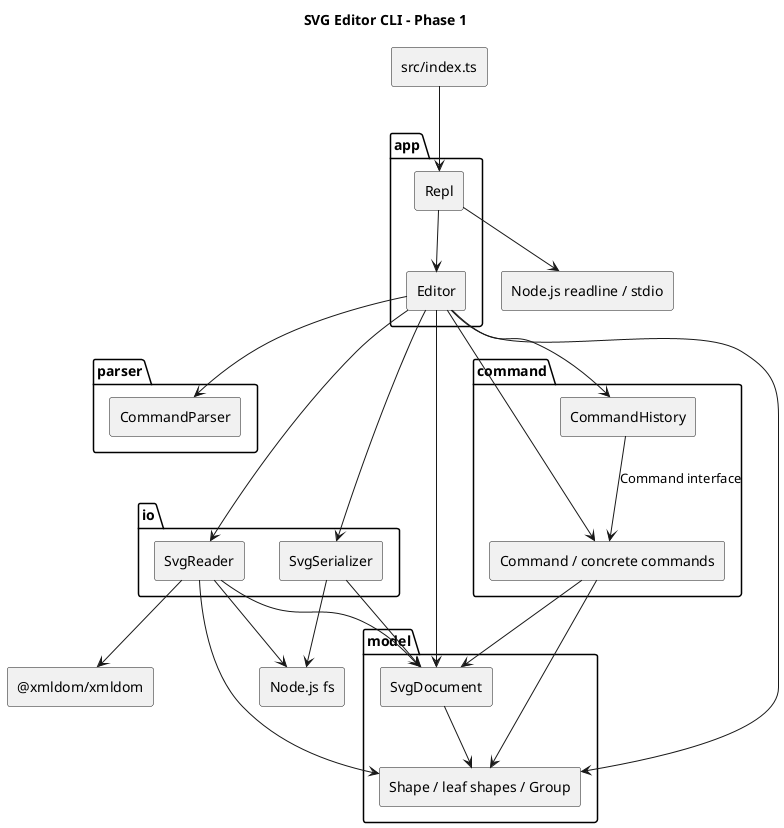

# SVG 编辑器 CLI：架构与实现说明

本文对应 `phase_cli_1.md` 中 Lab1 Phase 1 的文档要求，基于当前源码与 2026-10-27 的实际核验编写。

阶段范围为 TypeScript 面向对象 CLI，内置 `rect`、`circle`、`ellipse`、`line`、`text`、`g` 六种图形，支持文件读写、结构展示、编辑及撤销重做。`box` 与插件注册属于后续阶段，不作为本阶段已实现能力。

> 说明：本文是对现有实现的架构整理，不声称是开发前已确定的原始方案。过程记录只记录本次可核实的工作，不虚构历史对话、提交记录或已完成的修复。

## 一、架构方案

### 1. 模块划分

当前采用五个源码模块，由入口负责启动：

```text
src/
  index.ts
  app/
    Repl.ts
    Editor.ts
  parser/
    CommandParser.ts
  model/
    Shape.ts
    Rect.ts / Circle.ts / Ellipse.ts / Line.ts / TextShape.ts
    Group.ts
    SvgDocument.ts
  command/
    Command.ts
    CommandHistory.ts
    CreateCommand.ts / DeleteCommand.ts / MoveCommand.ts / ScaleCommand.ts
    SetCommand.ts / GroupCommand.ts / UngroupCommand.ts / AddtoCommand.ts
    FrontCommand.ts / BackCommand.ts
  io/
    SvgReader.ts
    SvgSerializer.ts
doc/
  README.md
```

| 模块 | 职责 | 关键类 |
|---|---|---|
| 入口 `index.ts` | 创建 REPL 并启动，不承载图形业务 | `Repl` 的装配 |
| `app` | 终端交互与应用编排；检查命令参数、定位对象、创建命令、调用历史与 IO | `Repl`、`Editor` |
| `parser` | 将命令行拆为参数，处理双引号、空行、整行注释及末尾 `in` 子句 | `CommandParser` |
| `model` | 封装几何数据、属性与组合树，维护画布、父子关系和 id 索引 | `Shape`、各图形类、`Group`、`SvgDocument` |
| `command` | 将一条编辑操作封装为对象，保存撤销信息并管理 undo/redo | `Command`、十个具体命令、`CommandHistory` |
| `io` | 文件读写、XML 解析及领域对象构建，隔离文件系统依赖 | `SvgReader`、`SvgSerializer` |

以下 PlantUML 组件图描述当前模块依赖，箭头表示调用或依赖方向，可由支持 PlantUML 的工具渲染：




当前由 `Editor` 直接创建命令、图形和文件读写对象，结构比较直观，也足以支持本阶段的 CLI 功能。如果后续需要替换文件读写方式，或在测试中模拟读写结果，可以再为文件读写定义接口，并从外部传入具体实现。模型负责生成 SVG 和图形说明文本，实际的文件写入和终端输出则分别由 `io` 和 `Repl` 完成。

### 2. 设计模式的选择与落地

本项目主要使用 Command（命令模式）和 Composite（组合模式）。编辑器需要支持撤销和重做，因此用命令模式把每次编辑及其撤销逻辑放在一起，方便统一管理操作历史；图形既有单独的矩形、圆等，也有包含多个图形的容器，因此用组合模式组织它们，让同一套操作既能作用于单个图形，也能作用于一组图形。此外，缩放操作借鉴了 Memento（备忘录模式）保存和恢复状态的思路，图形创建采用了简单工厂式的集中构建方式，分别用于恢复缩放前的属性和集中处理不同类型的创建逻辑。

#### 2.1 Command：编辑命令与撤销重做

Command（命令模式）的基本思路是把一次操作封装成一个对象。这个对象记录要操作谁、使用什么参数，并提供执行操作的方法。这样，发起操作的代码只需要调用命令对象，不必知道具体的操作细节；命令对象也可以被保存下来，用于后续的撤销和重做。

在这个编辑器中，每一条编辑命令都被打包成一个独立的动作单元。例如，`move r1 10 20` 对应一个 `MoveCommand` 对象，其中保存了图形 `r1` 和位移量 `(10, 20)`。即使一条命令涉及多个图形，例如 `group g1 r1 c1`，也只创建一个命令对象。因此，用户撤销一次，就会撤销整条编辑命令，而不是只恢复其中某个图形。

代码中的 `Command` 接口统一规定了 `execute()` 和 `undo()` 两个方法，分别用于执行和撤销。创建、删除、移动、缩放等操作各自实现一个命令类，如 `CreateCommand`、`DeleteCommand` 和 `MoveCommand`。这些类负责记录操作参数和撤销所需的信息，具体的图形修改则交给 `Shape`、`Group` 或 `SvgDocument` 完成。例如，`MoveCommand.execute()` 调用图形的 `move(dx, dy)`，`undo()` 则调用 `move(-dx, -dy)`，将图形移回原处。

不同操作需要保存的撤销信息不同。删除图形时，`DeleteCommand` 会保留图形对象，记录它原来的父容器和排列位置，撤销时再放回去；缩放时，`ScaleCommand` 会保存图形及其子孙修改前的属性，撤销时直接恢复，避免用除法反推原值带来的误差；分组时，`GroupCommand` 会记录每个图形原来的归属和位置，以便一次恢复整个分组操作。

`Editor` 负责把用户输入转成命令对象。它先借助 `CommandParser` 解析输入，再检查参数、根据 id 找到图形，最后创建相应的命令并交给 `CommandHistory` 执行。例如，处理 `move r1 10 20` 时，`Editor` 找到 `r1`，创建 `MoveCommand`，之后便不再负责这次移动如何执行、如何撤销。

`CommandHistory` 统一管理两个栈：撤销栈和重做栈。执行一条新编辑命令后，它把命令对象放入撤销栈，并清空重做栈；执行 `undo` 时，取出最近的命令，调用其 `undo()`，再放入重做栈；执行 `redo` 时，则取出重做栈中的命令，再调用一次 `execute()`。由于这些操作只依赖 `Command` 接口，历史管理类不需要分别编写移动、删除、分组等操作的处理逻辑。

这里封装的是可撤销的编辑命令。`tree`、`show`、`help` 等显示命令不进入历史；`init`、`read`、`save` 和画布尺寸修改按需求单独处理，并通过 `CommandHistory` 的标记暂时禁止撤销和重做，直到下一次编辑。当前新增属性的撤销和保存失败后的历史处理仍有问题，具体复现见“质量保证手段”一节。

#### 2.2 Composite：容器与叶子统一操作

`Shape` 是抽象基类，规定 `move`、`scale`、属性操作、展示和序列化行为。各叶子类封装几何数据并实现这些方法。

`Group` 同样继承 `Shape`，维护只读暴露的子节点列表；`move/scale` 递归调用子节点的同名方法。编辑命令无需按具体图形标签分派几何操作。删除容器时，`SvgDocument` 同时注销子孙 id，撤销时恢复整棵子树。

本阶段移动与缩放容器直接修改子孙坐标，不新增 `transform` 属性。普通 `g` 的 `set fill/stroke/stroke-width` 修改容器自身属性，SVG 渲染时遵循继承规则，不等同于未来 `box` 的插件传播语义。

#### 2.3 快照恢复思想与集中构建

`ScaleCommand` 使用局部快照恢复，具有 Memento 的思想，但没有独立、不透明的 Memento 类型，不将其描述为完整 Memento 模式。

`Editor.createShape` 集中构建六种图形，属于简单工厂式方法；目前不是独立工厂模块，也不是插件注册机制。`SvgReader.parseElement` 另有按标签构建对象的逻辑，两处未共享注册表，是待重构项。

#### 2.4 按名字分派的约束

需求允许命令分发与图形工厂两处按名字分派，并要求标注待重构：

| 位置 | 现状 | 后续处理 |
|---|---|---|
| `Editor.handleLine` | `switch(cmd)` 分发命令 | 替换为命令处理器注册表 |
| `Editor.createShape` | `switch(type)` 创建图形 | 抽出共享图形工厂/提供者注册表 |
| `SvgReader.parseElement` | 额外的 `switch(tag)` 构建读入对象 | 违反“两处”限制，合并进共享图形工厂 |

图形类内还有按属性名的 `switch(name)`，它们不是按图形标签选择行为；若课程对“按名字分派”采用更严格解释，也应改成各类封装的属性访问映射。不能以已有多态为由忽略额外的读入分派。

### 3. 依赖方向规则

依赖方向规定的是“哪个模块可以使用哪个模块的类和方法”。本项目由 `app` 组织一次完整的用户操作，`command` 负责执行编辑，`model` 负责图形本身的行为；命令解析和文件读写分别放在 `parser` 与 `io` 中。这样，修改输入方式或文件读写逻辑时，不需要让图形类反过来调用应用层。

各模块可以使用本模块内部的类型和语言基础能力；对其他模块和外部 IO 的依赖按下表限制，未列出的依赖不应引入。

| 模块 | 可以依赖 | 原因 |
|---|---|---|
| 入口 `index.ts` | `app` | 只负责启动程序，不直接处理编辑和读写 |
| `app` | `parser`、`command`、`model`、`io`；其中 `Repl` 可以使用终端 API | `Editor` 需要解析输入、查找图形、创建命令和调用读写器；终端交互集中在 `Repl` |
| `parser` | 无其他项目模块或外部 IO | 只把文本解析成参数，不查找图形，也不执行命令 |
| `command` | `model` | 命令可以修改图形和文档，但不应读取终端、访问文件或调用 `Editor` |
| `model` | 无其他项目模块或外部 IO | 图形行为不应依赖命令解析、历史管理或文件系统 |
| `io` | `model`、文件系统和 XML 库 | 负责在 SVG 文件与图形对象之间转换，不负责执行编辑命令或管理撤销历史 |

检查当前源码中的导入关系，未发现违反这些规则的跨模块依赖。例如，`MoveCommand` 只使用 `Command` 接口和 `Shape`，`SvgReader` 使用模型类、文件系统和 XML 库，而模型没有导入 `Editor` 或读写器。如果后续出现 `model -> app`、`command -> io` 等依赖，就应作为待处理项，重新安排相应代码的职责。

以下几处虽然存在具体类之间的依赖，但属于当前可以接受的设计：

- **`Editor` 创建具体命令和图形。** 它负责根据输入选择要执行的操作，因此需要知道具体类型。创建之后，`CommandHistory` 只通过 `Command` 接口管理历史，不需要知道每种命令的细节。对象由谁创建和命令如何分派是两个问题；分派方式仍需按第 2.4 节的要求处理。
- **`Editor` 直接使用 `SvgReader` 和 `SvgSerializer`。** 本阶段只有本地 SVG 文件读写，没有必须替换实现的需求，可以暂时保留。将来需要其他存储方式或模拟 IO 测试时，再引入接口和外部传入的实现，而不把当前缺少接口本身列为错误。
- **模型生成 SVG 和展示文本。** 这些方法只返回字符串，不直接读写文件或输出到终端，因此没有违反 IO 边界。对目前只支持 SVG 的 CLI，把图形自身的输出逻辑放在图形类中是可以接受的；支持多种格式或界面后，再考虑拆分。
- **`Shape` 与 `Group` 相互引用。** `Group` 继承 `Shape`，`Shape` 用 `Group` 类型表示父容器，这是组合树的内部关系，不是模块间的反向依赖。仅用于类型的导入可以改成 `import type`，但属于表达方式的改善，不是当前必须修复的架构问题。

因此，当前没有需要修复的跨模块依赖违规。与架构相关的明确待处理项主要是第 2.4 节中的分派方式：需求允许暂时保留命令分发和图形工厂两处分派，但要求标注待重构；`SvgReader.parseElement` 又增加了一处按标签分派，需要与图形创建逻辑统一。这是需求约束下的待处理项，不应与“所有具体类依赖都必须改成接口”混为一谈。

### 4. 变化点假设

变化点假设关注的是：需求继续发展时，哪些地方最可能需要调整，以及现在的设计能帮助我们少改哪些代码。结合后续插件化目标和编辑器的使用方式，主要考虑以下几处。数值校验、撤销失败等已有问题属于当前功能缺陷，不作为未来变化点。

#### 4.1 增加图形类型

最明确的变化是增加新的图形，尤其是需求中已经提到的复合图形 `box`。目前各图形继承 `Shape`，移动和缩放命令通过共同的方法操作它们；`Group` 则提供了组织子图形的能力。这意味着新类型只要实现相同的行为，已有的移动、缩放等命令就有机会直接复用。

不过，多态接口不等于已经支持插件。当前创建图形和读入 SVG 都写死了类型分支，增加类型仍需要修改这两处。下一步应先统一图形构建逻辑，再在插件化阶段引入 `ShapeProvider`，处理类型注册、参数、复合图形属性和读回还原。本阶段不提前实现 `box` 的全部机制，但保留 `Shape` 和组合树作为基础。

#### 4.2 增加编辑操作

后续可能增加旋转、对齐或复制等操作。现有 `Command` 接口已经把“如何执行和撤销”交给各个命令类，新操作可以实现自己的命令类，再交给 `CommandHistory` 管理，不需要在历史管理中增加对应分支。

目前仍要修改 `Editor` 的命令分发和帮助文本。命令种类继续增加时，可以把命令名、参数说明和构建逻辑统一登记，减少多处维护。现阶段先保留分发入口，并按需求将其标注为待重构；不为尚未确定的操作提前设计复杂的参数框架。

#### 4.3 增加交互方式

CLI 之外，后续可能通过图形界面或 agent 发起编辑。当前终端读写集中在 `Repl`，`Editor.handleLine()` 接收字符串并返回结果，因此其他调用者可以先通过这个入口复用编辑功能，无需启动终端交互。

但图形界面的拖拽、选择等操作不适合长期靠拼接命令行实现。如果确定要增加这类入口，再把 `Editor` 中的编辑操作整理成接收结构化参数的方法，让 CLI 解析器和其他入口共同调用。目前先保留终端与编辑逻辑的分离，不提前建设完整的 GUI 服务层。

#### 4.4 扩大文件支持范围

随着导入文件的来源增加，可能需要支持更多 SVG 属性、变换或样式。文件访问和 XML 解析已经放在 `io` 中，但属性保存及 SVG 文本生成仍在模型中。因此，扩大 SVG 支持范围通常需要同时调整读入器和相应图形类，而不是只替换读入器。

本阶段只处理已约定的图形和属性，不尝试实现通用 SVG 引擎。如果后续需要其他输出格式，再考虑把序列化从模型中拆出；如果需要网络或其他存储方式，再为读写定义可替换的接口。这两类变化目前都没有明确要求，暂不增加对应抽象。对于不支持的外部内容，应明确说明限制，而不能默认宣称无损读写。

#### 4.5 更长的操作历史和更大的文档

使用规模增大后，可能需要限制撤销次数、合并连续拖拽，或减少大图形树的快照占用。现有历史集中在 `CommandHistory`，撤销数据保存在具体命令中，后续可以分别调整历史保留策略和各操作的存储方式。

当前没有大文档性能测量，也没有跨会话恢复历史的要求，因此暂不实现历史持久化、命令合并或复杂快照机制。保留现有结构，等出现具体规模和性能目标后再决定优化方式。

## 二、过程记录

### 1. 可追溯范围

本节记录本次文档整理中实际发生的讨论与核验。当前仓库已有初始提交和远程配置，但这些信息不足以还原早期开发中的全部 AI 协作过程；这里不补写没有记录的历史讨论。

### 2. 本次关键步骤与确认结果

| 步骤 | 讨论或检查重点 | 证据与处理 |
|---|---|---|
| 需求确认 | 文档应放在哪里、覆盖哪些内容 | 阅读 `phase_cli_1.md`，确定为 `doc/README.md`，组织为四个必需章节 |
| 架构还原 | 是否真的采用 Command 与 Composite | 检查命令接口、历史栈、具体命令及 `Shape/Group`；将实际角色和调用链写入方案 |
| 边界校正 | 是否已有插件机制、统一工厂与独立序列化策略 | 发现目前没有注册接口，读入与创建各自分派，模型生成 SVG；删除无法由源码支持的成熟架构表述 |
| 依赖检查 | 是否存在底层反向依赖应用层 | 检索全部 import，确认跨模块方向符合本文规则；额外标签分派单独记录为范式待处理项 |
| 类型验证 | 本地工具是否能运行 | `npx tsc --noEmit` 因命令入口不可用失败；改用本地编译器直接执行，类型检查通过 |
| 功能核验 | 核心场景是否可用、撤销是否真正恢复状态 | 通过内存中 Node.js 断言执行器运行场景，核心抽样通过，同时确认三个边界缺陷 |
| 文档收敛 | 是否可声称功能完全达标 | 区分通过项、实测缺陷、静态风险与未验证项；本次只生成文档，不修改业务实现 |
| 表达调整 | 用户指出设计模式一节堆砌术语，不便理解 | 改为先介绍模式，再用一条编辑命令说明动作单元，最后解释各个类如何配合 |
| 设计取舍 | 具体类依赖是否都应算作缺陷 | 对照需求和源码，保留本阶段合理的直接依赖，将可选接口抽象与明确的分派待处理项分开 |
| 本轮复核 | 变化点、自查与质量结论是否前后一致 | 重写变化点，重新运行类型检查和核心抽样；区分当前缺陷、支持范围与可选工程改进 |

这里的“纠正”指文档结论的纠正，不意味着已修复代码。后续真实修复应记录复现输入、修改文件、验证结果和对应提交，而不是事后补写不存在的开发过程。

### 3. 修订记录

| 日期 | 修订 | 状态 |
|---|---|---|
| 2026-10-27 | 根据现有五模块结构整理架构方案与依赖图 | 已写入 |
| 2026-10-27 | 重新区分分派重构与可接受的具体类依赖、模型文本生成职责 | 保留分派待处理项，接口抽象和输出拆分按后续需求考虑；代码未改 |
| 2026-10-27 | 加入实际类型检查、功能抽样和已知问题，避免“全部达标”的无依据结论 | 已写入，缺陷待修复 |
| 2026-10-27 | 重写变化点假设，调整一致性自查与质量保证，修正文档图片路径 | 仅修改文档，重新核验后保留未修复问题 |

## 三、一致性自查

### 1. 模块划分是否一致

实际目录与第一章的模块划分一致：`app` 负责交互和操作组织，`parser` 解析命令，`command` 封装编辑和历史，`model` 保存图形并实现其行为，`io` 处理文件读写，`src/index.ts` 负责启动。各个类分别放在同名文件中，几何字段由图形类封装，移动和缩放也由图形对象自身完成。

这里需要明确两处职责边界：`Editor` 除了调度操作，还负责创建具体命令和图形；模型除了几何操作，还负责生成 SVG 和展示文本。这两点已经在方案中说明，属于本阶段保留的设计，不是遗漏的目录调整。此前文档中将这些选择笼统列为待改进项的表述已经修订，并记入第二章的修订记录。

本次对照的是本文整理后的方案与当前实现，没有发现未记录的目录差异。

### 2. 依赖方向是否被违反

检查 `src` 中的全部导入关系，并结合实际调用，未发现违反第一章第 3 节规则的跨模块依赖。以下是具有代表性的检查结果：

| 检查对象 | 实际情况 | 判断 |
|---|---|---|
| `Repl`、`Editor` | 前者处理终端，后者调用解析器、命令、模型和读写器 | 符合应用层组织操作的方向 |
| `CommandHistory` | 只通过 `Command` 接口执行、撤销和重做 | 不依赖具体图形或 IO |
| `MoveCommand`、`DeleteCommand` | 调用模型完成移动、删除与恢复，不调用应用层或读写器 | 符合 `command -> model` |
| `SvgReader`、`SvgSerializer` | 使用模型及文件系统；读入器另使用 XML 库 | 符合 `io -> model`，不负责历史管理 |
| `Shape`、`Group`、`SvgDocument` | 依赖模型内部类型，不导入应用层、命令层或 IO 类 | 没有跨模块反向依赖 |
| `CommandParser` | 不导入其他模块，不执行编辑 | 保持解析独立 |

直接使用具体类并不自动构成依赖违规。例如，`Editor` 创建 `MoveCommand` 是选择操作，`CommandHistory` 通过接口执行它是统一管理历史，两者职责不同。当前没有必要仅为减少具体类名称而给每个类增加接口。

### 3. 仍需处理的实现差异

依赖方向符合方案，但类型分派还没有完全满足需求。当前有 `Editor.handleLine` 的命令分发、`Editor.createShape` 的图形创建，以及 `SvgReader.parseElement` 的 SVG 标签分派。前两处按阶段要求保留并标记待重构；第三处需要与图形构建逻辑统一，不能因为它位于 `io` 模块就忽略。

这一问题已在第一章第 2.4 节记录。它与目录划分、模块依赖是不同的检查项，本轮只修订文档，尚未修改实现。功能方面的已知问题列在下一章，不重复算作依赖违规。

## 四、质量保证手段

### 1. 验证方法与范围

确认编辑器是否正确，不能只看命令是否返回“成功”。还需要检查图形属性和父子关系是否按预期变化，以及撤销后能否回到原来的状态。因此，这次检查分为源码核对、类型检查和命令场景验证三部分。

源码核对主要检查模块依赖、命令封装和图形多态是否与方案一致。类型检查在项目根目录执行：

```powershell
node node_modules/typescript/bin/tsc --noEmit
```

2026-10-27 本轮复核通过，没有诊断输出，也没有生成编译文件。项目启用了 TypeScript 的 `strict` 检查，但它不能代替运行时的数值、文件内容和图形关系校验。

命令场景通过 `node -r ts-node/register` 加载 `Editor`，使用 Node.js 的 `assert/strict` 对返回值、`tree` 和 `show` 结果作断言。正常操作检查修改后的状态，撤销检查是否恢复，错误输入检查是否被拒绝。本轮重新运行了此前的核心抽样，并再次复现下文的三个缺陷。

这些检查直接调用 `Editor.handleLine()`，没有覆盖 REPL 的完整终端交互，也没有验证浏览器中的视觉效果。执行用的断言脚本尚未保存为项目测试文件；下面的结果是本次抽样记录，不是持续运行的自动测试套件。

### 2. 已验证的功能

| 场景 | 实际检查与结果 |
|---|---|
| 初始化、注释和基本创建 | 无文档时的 `tree` 被拒绝；注释被忽略；默认画布和六种内置图形创建成功 |
| 嵌套容器与文字参数 | 通过 `in` 创建嵌套结构，带空格的文字内容正确 |
| 容器移动与缩放 | 移动后子图形坐标变化；移动的 undo 恢复原树，redo 再次应用；缩放的 undo 恢复原树 |
| 文字修改与容器删除 | 已有文字修改后可撤销；删除容器后子孙不可定位，撤销后恢复 |
| 结构和顺序调整 | `group` 撤销后恢复原树，重做后组再次出现；`addto` 撤销后恢复父级；`front/back` 和嵌套 `ungroup` 撤销后恢复原树 |
| 常见错误输入 | 重复 id、缺失 id、零缩放、未知属性、祖先与后代一起分组、未支持的 `box` 均返回错误；这些抽样操作没有改变树 |
| 撤销与重做规则 | undo 后进行新编辑会清空 redo；修改画布尺寸后 undo 被禁止；根级容器解散被拒绝 |
| 示例文件导入 | `read other.svg` 为无 id 矩形分配 `rect1` 并警告，读入画布尺寸为 400×300 |

这些结果说明基本编辑流程可以运行，但不能据此推断所有命令的边界情况和往返恢复都正确。例如，正常文字修改可以撤销，不代表原本不存在的 `fill` 属性也能正确撤销。

### 3. 已复现的功能问题

#### Q1：撤销新增属性没有恢复“属性不存在”

复现：

```text
init
create rect r 0 0 10 10
set r fill red
undo
show r
```

预期撤销后图形不再具有显式的 `fill` 属性，实际 `show` 仍包含 `fill=red`。`SetCommand.undo()` 只在旧值不是 `undefined` 时恢复，缺少移除新增属性的处理。后续应区分“原本未设置”和“原本有值”，并补充新增公共属性的撤销测试。

#### Q2：非法数值可以进入模型

复现：

```text
init
create rect r 0 0 10 10
scale r invalid
```

预期返回参数错误且图形不变，实际返回 `scaled by NaN`。`Number()` 转换后没有检查结果是否为有限数，而 `NaN <= 0` 为假，绕过了现有检查。后续应统一验证几何输入和画布尺寸，在修改状态前拒绝非法值。

#### Q3：失败保存改变应用状态

复现，目标目录须不存在：

```text
init
create rect r 0 0 10 10
save __nonexistent_doc_check__/a.svg
undo
```

预期保存失败不影响原来的撤销能力，实际 undo 返回 `error: undo not allowed after io command`。`Editor.handleSave()` 在确认写入成功前就更新保存路径并设置历史禁止标记。后续应在保存成功后再更新这些状态，并分别检查失败前后的路径和历史是否一致。

以上三个问题在本轮复核中仍然存在。本轮没有修改业务代码，也没有把“成功复现缺陷”记作对应功能通过。

### 4. 代码检查中需要继续核实的问题

除已复现的问题外，源码中还有以下值得优先检查的位置。本轮没有逐项做运行验证，因此保留具体依据和下一步检查方法。

| 问题 | 代码依据 | 下一步检查 |
|---|---|---|
| 容器可能被移入自己或后代 | `handleAddto`、`AddtoCommand` 没有对应关系检查，添加后还会递归注册子孙 | 检查是否形成循环或抛出异常，拒绝操作时树应保持不变 |
| 自动 id 多次冲突可能无法结束 | `SvgReader.autoId` 循环中始终使用初始的 `count + 1` | 构造已有 `rect1`、`rect2` 和无 id 矩形的文件，在带超时的测试中验证 |
| 外部文件的重复 id 没有被拒绝 | Set 只收集已用 id，Map 注册同名对象时可能覆盖 | 导入重复 id 文件，检查树和索引是否一致，以及失败时是否保留旧文档 |
| 分组可能改变原顺序或重复加入同一对象 | `GroupCommand` 按参数顺序添加图形，没有去重 | 测试逆序参数、跨父级分组和重复 id，核对相对顺序与撤销结果 |
| SVG 属性值可能生成非法 XML | id 和公共属性值直接拼接，文本内容的转义不能保护属性值 | 测试包含引号、`&`、`<` 的属性，检查保存后能否正确读回 |
| 非法 XML 的错误处理不统一 | `SvgReader.read` 捕获了文件读取异常，但 XML 解析不在该捕获范围内 | 区分解析器警告、可恢复输入和抛出异常的情况，检查错误输出及原文档状态 |
| 命令语法检查不完整 | 解析器接受未闭合双引号，部分处理器只检查最少参数数量 | 测试引号缺失、多余参数和不完整的 `in` 子句，明确报错规则 |

未知 SVG 元素会被读入器跳过，`transform`、`style`、`data-kind` 等信息也没有被保存。这属于当前支持范围的限制，不能笼统等同于“必须实现完整 SVG”。其中 `box` 和相关插件标记属于后续阶段；未知内容采用警告还是拒绝导入，需要明确策略。当前不能承诺任意外部 SVG 读写后保持原样。

### 5. 后续验证安排

下一轮修改代码时，应先为已知问题写出能够复现的用例，再修复实现并回归正常场景。优先关注会破坏图形树、丢失原状态或让命令无法结束的问题，而不是先增加新的架构接口。

完整验收还需补足以下证据：

- 对每个编辑命令检查执行、撤销和重做后的状态。除了 `tree` 文本，还应比较全部属性、父子顺序和 id 索引，避免漏掉树摘要未展示的差异。
- 对错误输入检查文档、保存路径和历史均不改变，覆盖非法数值、对象不存在、循环层级和读写失败。
- 在临时目录验证正常保存、无参数保存、读回，以及支持的图形和属性往返后是否一致。本轮只检查了示例读入和一次失败保存，尚未完成这部分。
- 回放需求中的完整会话与两节点流程图，检查 REPL 输出，并在浏览器中预览保存的 SVG。
- 处理额外标签分派后重新检查源码；命令分发和图形工厂的阶段性保留仍按需求记录，不要求为了形式统一而一次性重写所有模块。

建议把这些用例保存为可重复运行的测试，提供统一测试命令。当前项目没有 `test` 脚本或自动测试套件；CI 可以在用例稳定后接入，但它是持续验证的手段，不是本阶段需求指定的唯一验收方式。

Git 提交属于交付检查，不等同于功能验证。截至本轮文档提交前，本地可见初始提交 `e2cb4bf`，已配置 `origin`，本地未列出 `final` 标签。这只能说明本地记录和配置，不能证明已经推送或满足截止时间要求。最终仍需核实远程提交和 `final` 标签；本轮提交是文档修订，不作为最终验收完成的标记。

### 6. 当前结论

目前已有明确的模块分工，Command 和 Composite 的实现也能支持基本编辑流程；类型检查与核心命令抽样提供了相应证据。但三个已复现问题仍未修复，正常文件保存与读回、完整终端交互和视觉效果也尚未验证，所以现在还不能确认功能已全部完成。

本轮完成的是文档校正：说明哪些设计可以保留，哪些问题需要修复，以及还缺什么验证。下一轮应先解决这些问题，再根据回归结果更新结论。
