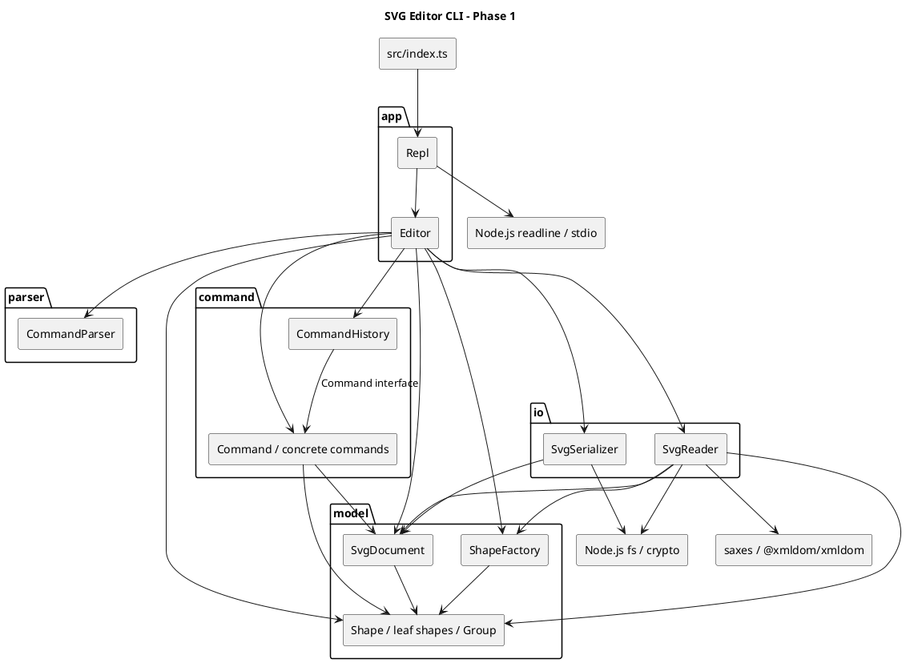
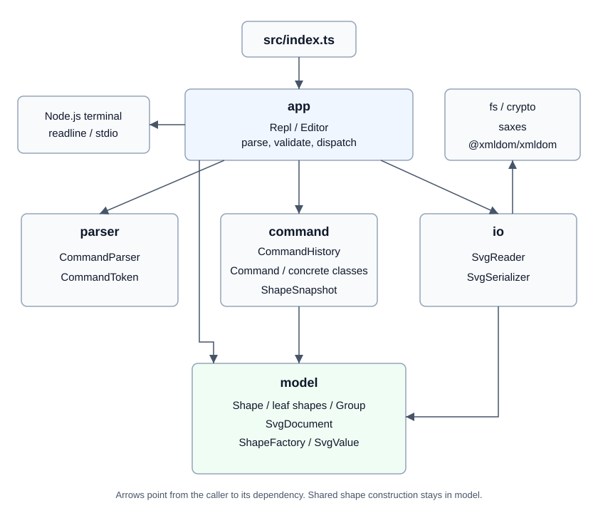

# SVG 编辑器 CLI：架构与实现说明

本文对应 `phase_cli_1.md` 中 Lab1 Phase 1 的文档要求，基于当前源码与 2026-10-27 的实际核验编写。

阶段范围为 TypeScript 面向对象 CLI，内置 `rect`、`circle`、`ellipse`、`line`、`text`、`g` 六种图形，支持文件读写、结构展示、编辑及撤销重做。`box` 与插件注册属于后续阶段，不作为本阶段已实现能力。

> 说明：本文是对现有实现的架构整理，不声称是开发前已确定的原始方案。过程记录只记录本次可核实的工作，不虚构历史对话、提交记录或已完成的修复。

## 一、架构方案

### 1. 模块划分

当前采用五个源码模块，由入口负责启动：

```text
src/
  index.ts
  app/
    Repl.ts
    Editor.ts
  parser/
    CommandParser.ts
    CommandToken.ts
  model/
    Shape.ts
    Rect.ts / Circle.ts / Ellipse.ts / Line.ts / TextShape.ts
    Group.ts
    SvgDocument.ts
    ShapeFactory.ts
    SvgValue.ts
  command/
    Command.ts
    CommandHistory.ts
    ShapeSnapshot.ts
    CreateCommand.ts / DeleteCommand.ts / MoveCommand.ts / ScaleCommand.ts
    SetCommand.ts / GroupCommand.ts / UngroupCommand.ts / AddtoCommand.ts
    FrontCommand.ts / BackCommand.ts
  io/
    SvgReader.ts
    SvgSerializer.ts
doc/
  README.md
  architecture.svg
tests/
  Editor.test.cjs
```

| 模块 | 职责 | 关键类 |
|---|---|---|
| 入口 `index.ts` | 创建 REPL 并启动，不承载图形业务 | `Repl` 的装配 |
| `app` | 终端交互与应用编排；检查命令参数、定位对象、创建命令、调用历史与 IO | `Repl`、`Editor` |
| `parser` | 将命令行拆为参数，保留引号信息，处理空行、注释及末尾 `in` 子句 | `CommandParser`、`CommandToken` |
| `model` | 封装几何数据和组合树，维护 id 索引，集中创建图形并校验属性 | `Shape`、各图形类、`Group`、`SvgDocument`、`ShapeFactory`、`SvgValue` |
| `command` | 将一条编辑操作封装为对象，保存撤销信息并管理 undo/redo | `Command`、十个具体命令、`CommandHistory`、`ShapeSnapshot` |
| `io` | 严格校验 XML、读写 SVG，调用模型工厂完成对象构建 | `SvgReader`、`SvgSerializer` |

以下 PlantUML 组件图描述当前模块依赖，箭头表示调用或依赖方向，可由支持 PlantUML 的工具渲染：





当前由 `Editor` 直接创建命令和文件读写对象，图形创建则委托给 `ShapeFactory`，供 CLI 和 SVG 读入共同使用。这样的结构足以支持本阶段的 CLI 功能。如果后续需要替换文件读写方式，可以再为文件读写定义接口，并从外部传入具体实现。模型负责生成 SVG 和图形说明文本，实际的文件写入和终端输出则分别由 `io` 和 `Repl` 完成。

### 2. 设计模式的选择与落地

本项目主要使用 Command（命令模式）和 Composite（组合模式）。编辑器需要支持撤销和重做，因此用命令模式把每次编辑及其撤销逻辑放在一起，方便统一管理操作历史；图形既有单独的矩形、圆等，也有包含多个图形的容器，因此用组合模式组织它们，让同一套操作既能作用于单个图形，也能作用于一组图形。此外，移动和缩放操作借鉴了 Memento（备忘录模式）保存和恢复状态的思路，图形创建采用简单工厂，分别用于精确恢复操作前的属性，以及让 CLI 和文件读入共享同一套创建逻辑。

#### 2.1 Command：编辑命令与撤销重做

Command（命令模式）的基本思路是把一次操作封装成一个对象。这个对象记录要操作谁、使用什么参数，并提供执行操作的方法。这样，发起操作的代码只需要调用命令对象，不必知道具体的操作细节；命令对象也可以被保存下来，用于后续的撤销和重做。

在这个编辑器中，每一条编辑命令都被打包成一个独立的动作单元。例如，`move r1 10 20` 对应一个 `MoveCommand` 对象，其中保存了图形 `r1` 和位移量 `(10, 20)`。即使一条命令涉及多个图形，例如 `group g1 r1 c1`，也只创建一个命令对象。因此，用户撤销一次，就会撤销整条编辑命令，而不是只恢复其中某个图形。

代码中的 `Command` 接口统一规定了 `execute()` 和 `undo()` 两个方法，分别用于执行和撤销。创建、删除、移动、缩放等操作各自实现一个命令类，如 `CreateCommand`、`DeleteCommand` 和 `MoveCommand`。这些类负责记录操作参数和撤销所需的信息，具体的图形修改则交给 `Shape`、`Group` 或 `SvgDocument` 完成。例如，`MoveCommand.execute()` 先保存状态，再调用图形的 `move(dx, dy)`；`undo()` 恢复保存的属性。这样即使位移量是小数，也不会因反向计算而留下精度误差。

不同操作需要保存的撤销信息不同。删除图形时，`DeleteCommand` 会保留图形对象，记录它原来的父容器和排列位置，撤销时再放回去；缩放时，`ScaleCommand` 会保存图形及其子孙修改前的属性，撤销时直接恢复，避免用除法反推原值带来的误差；分组时，`GroupCommand` 会记录每个图形原来的归属和位置，以便一次恢复整个分组操作。

`Editor` 负责把用户输入转成命令对象。它先借助 `CommandParser` 解析输入，再检查参数、根据 id 找到图形，最后创建相应的命令并交给 `CommandHistory` 执行。例如，处理 `move r1 10 20` 时，`Editor` 找到 `r1`，创建 `MoveCommand`，之后便不再负责这次移动如何执行、如何撤销。

`CommandHistory` 统一管理两个栈：撤销栈和重做栈。执行一条新编辑命令成功后，它把命令对象放入撤销栈，并清空重做栈；执行 `undo` 时，先调用最近命令的 `undo()`，成功后再把它移入重做栈；执行 `redo` 时，再次调用 `execute()`，成功后移回撤销栈。命令报错或抛出异常时不移动栈中的记录。由于这些操作只依赖 `Command` 接口，历史管理类不需要分别编写移动、删除、分组等操作的处理逻辑。

这里封装的是可撤销的编辑命令。`tree`、`show`、`help` 等显示命令不进入历史；`init`、`read`、`save` 和画布尺寸修改在成功后暂时禁止撤销和重做，直到下一次编辑。保存失败不修改路径和历史。设置原本不存在的公共属性后撤销，会真正移除该属性，恢复 SVG 默认值或父容器继承的效果。

#### 2.2 Composite：容器与叶子统一操作

`Shape` 是抽象基类，规定 `move`、`scale`、属性操作、展示和序列化行为。各叶子类封装几何数据并实现这些方法。

`Group` 同样继承 `Shape`，维护只读暴露的子节点列表；`move/scale` 递归调用子节点的同名方法。编辑命令无需按具体图形标签分派几何操作。删除容器时，`SvgDocument` 同时注销子孙 id，撤销时恢复整棵子树。

本阶段移动与缩放容器直接修改子孙坐标，不新增 `transform` 属性。普通 `g` 的 `set fill/stroke/stroke-width` 修改容器自身属性，SVG 渲染时遵循继承规则，不等同于未来 `box` 的插件传播语义。

#### 2.3 快照恢复思想与集中构建

`MoveCommand` 和 `ScaleCommand` 通过 `ShapeSnapshot` 保存目标图形及其子孙修改前的属性。撤销时恢复快照；执行时如果计算结果溢出，也恢复快照并返回错误，避免容器内只修改了一部分图形。它借鉴了 Memento 的状态保存思想，但属性仍由模型以记录形式提供，不是严格封装的不透明备忘录。

`model/ShapeFactory` 集中创建六种内置图形。CLI 根据各图形提供的创建参数说明设置属性，读入器根据 SVG 属性设置同一类对象；两条路径都使用模型中的属性校验，因此新增图形不再需要维护两个类型分支。工厂目前仍是固定的内置类型集合，不是插件注册机制。

#### 2.4 按名字分派的约束

需求允许命令分发与图形工厂两处按名字分派，并要求标注待重构：

| 位置 | 现状 | 后续处理 |
|---|---|---|
| `Editor.dispatch` | `switch(cmd)` 分发命令，`handleLine` 统一处理异常 | 待重构：替换为命令处理器注册表 |
| `ShapeFactory.create` | 唯一的 `switch(type)`，供 CLI 和读入器共用 | 待重构：改为图形提供者注册表 |

原来 `SvgReader.parseElement` 中额外的标签分派已移除。图形类内仍有按属性名的 `switch(name)`，用于对象自身的属性访问，不是按图形类型选择行为；这里保留这一边界，不把它当成新的图形分派入口。

### 3. 依赖方向规则

依赖方向规定的是“哪个模块可以使用哪个模块的类和方法”。本项目由 `app` 组织一次完整的用户操作，`command` 负责执行编辑，`model` 负责图形本身的行为；命令解析和文件读写分别放在 `parser` 与 `io` 中。这样，修改输入方式或文件读写逻辑时，不需要让图形类反过来调用应用层。

各模块可以使用本模块内部的类型和语言基础能力；对其他模块和外部 IO 的依赖按下表限制，未列出的依赖不应引入。

| 模块 | 可以依赖 | 原因 |
|---|---|---|
| 入口 `index.ts` | `app` | 只负责启动程序，不直接处理编辑和读写 |
| `app` | `parser`、`command`、`model`、`io`；其中 `Repl` 可以使用终端 API | `Editor` 需要解析输入、查找图形、创建命令和调用读写器；终端交互集中在 `Repl` |
| `parser` | 无其他项目模块或外部 IO | 只把文本解析成参数，不查找图形，也不执行命令 |
| `command` | `model` | 命令可以修改图形和文档，但不应读取终端、访问文件或调用 `Editor` |
| `model` | 无其他项目模块或外部 IO | 图形行为不应依赖命令解析、历史管理或文件系统 |
| `io` | `model`、文件系统、标准库随机标识工具和 XML 库 | 负责在 SVG 文件与图形对象之间转换及临时文件命名，不负责编辑命令或撤销历史 |

检查当前源码中的导入关系，未发现违反这些规则的跨模块依赖。例如，`MoveCommand` 使用本模块的命令接口、快照类和模型中的图形、数值校验；`SvgReader` 使用模型类、文件系统和 XML 库，而模型没有导入 `Editor` 或读写器。如果后续出现 `model -> app`、`command -> io` 等依赖，就应重新安排相应代码的职责。

以下几处虽然存在具体类之间的依赖，但属于当前可以接受的设计：

- **`Editor` 创建具体命令并调用图形工厂。** 它负责根据输入选择要执行的操作。创建之后，`CommandHistory` 只通过 `Command` 接口管理历史，不需要知道每种命令的细节。对象由谁创建和命令如何分派是两个问题；阶段性保留的两处分派见第 2.4 节。
- **`Editor` 直接使用 `SvgReader` 和 `SvgSerializer`。** 本阶段只有本地 SVG 文件读写，没有必须替换实现的需求，可以暂时保留。将来需要其他存储方式或模拟 IO 测试时，再引入接口和外部传入的实现，而不把当前缺少接口本身列为错误。
- **模型生成 SVG 和展示文本。** 这些方法只返回字符串，不直接读写文件或输出到终端，因此没有违反 IO 边界。对目前只支持 SVG 的 CLI，把图形自身的输出逻辑放在图形类中是可以接受的；支持多种格式或界面后，再考虑拆分。
- **`Shape` 与 `Group` 相互引用。** `Group` 继承 `Shape`，`Shape` 用 `Group` 类型表示父容器，这是组合树的内部关系，不是模块间的反向依赖。`Shape` 现在使用 `import type` 表达这一类型关系。

因此，当前没有发现跨模块依赖违规，额外的读入分派也已合并。命令分发和图形工厂的注册机制留到后续阶段，不要求把所有具体类依赖都改成接口。

### 4. 变化点假设

变化点假设关注的是：需求继续发展时，哪些地方最可能需要调整，以及现在的设计能帮助我们少改哪些代码。结合后续插件化目标和编辑器的使用方式，主要考虑以下几处。数值校验、撤销恢复等正确性问题在本轮处理，不作为未来变化点。

#### 4.1 增加图形类型

最明确的变化是增加新的图形，尤其是需求中已经提到的复合图形 `box`。目前各图形继承 `Shape`，移动和缩放命令通过共同的方法操作它们；`Group` 则提供了组织子图形的能力。这意味着新类型只要实现相同的行为，已有的移动、缩放等命令就有机会直接复用。

不过，多态接口不等于已经支持插件。当前 CLI 和 SVG 读入已经共享工厂，但增加类型仍需要修改 `ShapeFactory.create`。插件化阶段再引入 `ShapeProvider`，处理类型注册、参数、复合图形属性和读回还原。本阶段不提前实现 `box` 的全部机制，先保留共享工厂、`Shape` 和组合树作为基础。

#### 4.2 增加编辑操作

后续可能增加旋转、对齐或复制等操作。现有 `Command` 接口已经把“如何执行和撤销”交给各个命令类，新操作可以实现自己的命令类，再交给 `CommandHistory` 管理，不需要在历史管理中增加对应分支。

目前仍要修改 `Editor` 的命令分发和帮助文本。命令种类继续增加时，可以把命令名、参数说明和构建逻辑统一登记，减少多处维护。现阶段先保留分发入口，并按需求将其标注为待重构；不为尚未确定的操作提前设计复杂的参数框架。

#### 4.3 增加交互方式

CLI 之外，后续可能通过图形界面或 agent 发起编辑。当前终端读写集中在 `Repl`，`Editor.handleLine()` 接收字符串并返回结果，因此其他调用者可以先通过这个入口复用编辑功能，无需启动终端交互。

但图形界面的拖拽、选择等操作不适合长期靠拼接命令行实现。如果确定要增加这类入口，再把 `Editor` 中的编辑操作整理成接收结构化参数的方法，让 CLI 解析器和其他入口共同调用。目前先保留终端与编辑逻辑的分离，不提前建设完整的 GUI 服务层。

#### 4.4 扩大文件支持范围

随着导入文件的来源增加，可能需要支持更多 SVG 属性、变换或样式。文件访问和 XML 解析已经放在 `io` 中，但属性保存及 SVG 文本生成仍在模型中。因此，扩大 SVG 支持范围通常需要同时调整读入器和相应图形类，而不是只替换读入器。

本阶段只处理已约定的图形和属性，不尝试实现通用 SVG 引擎。如果后续需要其他输出格式，再考虑把序列化从模型中拆出；如果需要网络或其他存储方式，再为读写定义可替换的接口。这两类变化目前都没有明确要求，暂不增加对应抽象。对于不支持的外部内容，应明确说明限制，而不能默认宣称无损读写。

#### 4.5 更长的操作历史和更大的文档

使用规模增大后，可能需要限制撤销次数、合并连续拖拽，或减少大图形树的快照占用。现有历史集中在 `CommandHistory`，撤销数据保存在具体命令中，后续可以分别调整历史保留策略和各操作的存储方式。

当前没有大文档性能测量，也没有跨会话恢复历史的要求，因此暂不实现历史持久化、命令合并或复杂快照机制。保留现有结构，等出现具体规模和性能目标后再决定优化方式。

## 二、过程记录

### 1. 可追溯范围

本节记录文档整理及本轮缺陷修复中实际发生的讨论与核验。初始提交为 `e2cb4bf`，前一轮文档修订为 `cf6659d`；这些信息不足以还原早期开发中的全部 AI 协作过程，这里不补写没有记录的历史讨论。

### 2. 本次关键步骤与确认结果

| 步骤 | 讨论或检查重点 | 证据与处理 |
|---|---|---|
| 需求确认 | 文档应放在哪里、覆盖哪些内容 | 阅读 `phase_cli_1.md`，确定为 `doc/README.md`，组织为四个必需章节 |
| 架构还原 | 是否真的采用 Command 与 Composite | 检查命令接口、历史栈、具体命令及 `Shape/Group`；将实际角色和调用链写入方案 |
| 初次边界校正 | 当时是否已有插件机制、统一工厂与独立序列化策略 | 初版没有注册接口，读入与创建各自分派，模型生成 SVG；删除无法由源码支持的成熟架构表述 |
| 依赖检查 | 是否存在底层反向依赖应用层 | 检索全部 import，确认跨模块方向符合本文规则；额外标签分派单独记录为范式待处理项 |
| 类型验证 | 本地工具是否能运行 | `npx tsc --noEmit` 因命令入口不可用失败；改用本地编译器直接执行，类型检查通过 |
| 功能核验 | 核心场景是否可用、撤销是否真正恢复状态 | 通过内存中 Node.js 断言执行器运行场景，核心抽样通过，同时确认三个边界缺陷 |
| 文档收敛 | 是否可声称功能完全达标 | 前一阶段仅生成和调整文档，区分实测缺陷、静态风险与未验证项 |
| 表达调整 | 用户指出设计模式一节堆砌术语，不便理解 | 改为先介绍模式，再用一条编辑命令说明动作单元，最后解释各个类如何配合 |
| 设计取舍 | 具体类依赖是否都应算作缺陷 | 对照需求和源码，保留本阶段合理的直接依赖，将可选接口抽象与明确的分派待处理项分开 |
| 文档复核 | 变化点、自查与质量结论是否前后一致 | 重写变化点，运行类型检查和核心抽样；区分当前缺陷、支持范围与可选工程改进 |
| 本轮复现 | 将问题变成可以重复运行的用例 | 第一批 64 个测试在旧实现上有 53 个失败，覆盖已知问题，并发现浮点移动撤销误差及 line 的 fill 读回丢失 |
| 本轮修复 | 先保证状态可恢复，再统一输入和文件处理 | 补齐属性移除、快照恢复、参数校验、容器关系检查、分组顺序、严格 XML 校验和安全保存；共享图形工厂 |
| 扩展回归 | 修复是否影响已有操作和需求示例 | 测试扩展到 84 个，全部通过；包括写入/重命名失败模拟、REPL 子进程和两段需求会话回放 |

文档修订与代码修复是两个阶段。前一阶段保留的待修复记录用于追踪发现过程；本轮的具体修复位置和回归结果见第四章。

### 3. 修订记录

| 日期 | 修订 | 状态 |
|---|---|---|
| 2026-10-27 | 根据现有五模块结构整理架构方案与依赖图 | 已写入 |
| 2026-10-27 | 重新区分分派重构与可接受的具体类依赖、模型文本生成职责 | 保留分派待处理项，接口抽象和输出拆分按后续需求考虑；代码未改 |
| 2026-10-27 | 加入实际类型检查、功能抽样和已知问题，避免“全部达标”的无依据结论 | 当时记录为待修复，本轮处理结果见第四章 |
| 2026-10-27 | 重写变化点假设，调整一致性自查与质量保证，修正文档图片路径 | 仅修改文档，重新核验后保留未修复问题 |
| 2026-10-27 | 修复已知缺陷，新增共享工厂、严格 XML 校验和自动回归入口 | 84 个测试通过，文档同步为当前实现；变更归入本轮修复提交 |

## 三、一致性自查

### 1. 模块划分是否一致

实际目录与第一章的模块划分一致：`app` 负责交互和操作组织，`parser` 解析命令，`command` 封装编辑和历史，`model` 保存图形并实现其行为，`io` 处理文件读写，`src/index.ts` 负责启动。各个类分别放在同名文件中，几何字段由图形类封装，移动和缩放也由图形对象自身完成。

这里需要明确两处职责边界：`Editor` 除了调度操作，还负责创建具体命令并调用图形工厂；模型除了几何操作，还负责生成 SVG 和展示文本。这两点是本阶段保留的设计。本轮新增的 `ShapeFactory` 和 `SvgValue` 放在 `model`，`ShapeSnapshot` 放在 `command`，`CommandToken` 放在 `parser`，没有增加新的跨模块反向依赖。

本次对照的是本文整理后的方案与当前实现，没有发现未记录的目录差异。

### 2. 依赖方向是否被违反

检查 `src` 中的全部导入关系，并结合实际调用，未发现违反第一章第 3 节规则的跨模块依赖。以下是具有代表性的检查结果：

| 检查对象 | 实际情况 | 判断 |
|---|---|---|
| `Repl`、`Editor` | 前者处理终端，后者调用解析器、命令、模型和读写器 | 符合应用层组织操作的方向 |
| `CommandHistory` | 只通过 `Command` 接口执行、撤销和重做 | 不依赖具体图形或 IO |
| `MoveCommand`、`DeleteCommand` | 调用模型完成移动、删除与恢复，不调用应用层或读写器 | 符合 `command -> model` |
| `SvgReader`、`SvgSerializer` | 使用模型及文件系统；读入器另使用 XML 库 | 符合 `io -> model`，不负责历史管理 |
| `Shape`、`Group`、`SvgDocument` | 依赖模型内部类型，不导入应用层、命令层或 IO 类 | 没有跨模块反向依赖 |
| `CommandParser` | 不导入其他模块，不执行编辑 | 保持解析独立 |

直接使用具体类并不自动构成依赖违规。例如，`Editor` 创建 `MoveCommand` 是选择操作，`CommandHistory` 通过接口执行它是统一管理历史，两者职责不同。当前没有必要仅为减少具体类名称而给每个类增加接口。

### 3. 分派约束是否一致

当前按命令名和图形类型分派的入口分别为 `Editor.dispatch` 和 `ShapeFactory.create`。读入器不再维护另一套类型分支，而是通过共享工厂创建对象，再按对象提供的属性白名单设置值。两处保留分派均已在第一章第 2.4 节标注后续重构方向。

这项修复只统一类型创建，没有引入插件接口，也没有改变容器和叶子通过多态执行编辑的方式。

## 四、质量保证手段

### 1. 如何运行验证

建议使用 Node.js 20 或更新版本。在项目根目录执行：

```powershell
npm ci
npm run check
npm test
npm run build
npm run cli
```

`check` 执行 TypeScript 严格类型检查，`test` 使用 Node.js 自带的测试框架加载 `tests/Editor.test.cjs`，不需要额外的测试框架。构建输出在 `dist/`，也可以向构建命令传入 `--outDir` 指定其他位置。依赖以 `package.json` 和 `package-lock.json` 为准；不要依赖仓库初始版本附带的 `node_modules` 快照，首次使用应运行 `npm ci`。

测试用 `ts-node/register` 加载源码，以 `assert/strict` 检查结果。文件场景全部写入系统临时目录，并在测试后清理；自动 id 的死循环回归和 REPL 检查运行在有超时限制的子进程中。

### 2. 本轮验证结果

2026-10-27，在 Windows、Node.js 24.14.0、npm 11.9.0 环境下，类型检查通过，84 个自动测试全部通过。在系统临时目录另建不含现有依赖的副本，执行 `npm ci`、类型检查、完整构建和整套测试也通过；编译后的 `dist/index.js` 已运行创建、移动、撤销及显示场景。第一批测试在旧实现上出现的失败已经转为通过，后续又补充了严格 XML、文件失败和需求会话用例。测试数量不是代码覆盖率，不代表穷尽了所有输入。

| 检查内容 | 验证方式 |
|---|---|
| 十种编辑命令 | 连续三轮执行 undo/redo，对比完整 SVG、保存路径和遍历顺序，并逐节点检查父级与 id 索引 |
| 状态不变性 | 错误输入前后比较文档、路径、撤销栈、重做栈和 IO 禁止标记 |
| 属性撤销 | 检查新增 fill、stroke、stroke-width 的移除，以及恢复父容器样式继承 |
| 小数与溢出 | 小数移动、缩放可以精确撤销；容器中某个子图形溢出时整次操作恢复 |
| 容器结构 | 拒绝自包含、祖先移入后代、重复分组；逆序和跨父级分组按原文档遍历顺序排列 |
| SVG 往返 | 六种内置图形、公共属性、特殊字符、空字符串和文本空白保存后读回，再保存结果一致 |
| 保存失败 | 检查目录不存在；模拟写入中断和重命名失败，确认原文件、应用状态不变且临时文件被清理 |
| 导入失败 | 重复 id、非法数值、畸形 XML、非法实体和字符、过深嵌套均被拒绝，旧文档与历史保留 |
| 自动 id | 跳过已有 rect1、rect2，生成 rect3、rect4；每次读入重置计数，显式 id 区分大小写 |
| 需求会话 | 从 `phase_cli_1.md` 提取典型会话和两节点流程图的命令回放，检查错误场景、结构及最终状态 |
| REPL | 子进程输入正确和错误命令，检查提示符、错误输出、后续命令仍可执行 |

测试会读取部分 TypeScript 私有字段以核对索引和历史，这是测试中的内部状态检查，没有为此给应用增加公开接口。

### 3. 原有缺陷的修复记录

| 编号 / 问题 | 修改位置与处理 | 回归结果 |
|---|---|---|
| Q1：新增属性撤销后仍存在 | `Shape.removeAttribute` 与 `SetCommand.undo` 区分未设置和已有值 | 新增公共属性可移除，父级继承恢复 |
| Q2：非法数值进入模型 | `SvgValue` 统一数值校验；入口和模型属性设置共用规则；移动、缩放溢出由快照恢复 | NaN、Infinity、负尺寸及计算溢出被拒绝，状态不变 |
| Q3：失败保存改变路径与历史 | `Editor.handleSave` 在成功后更新状态；`SvgSerializer` 先写临时文件再替换目标 | 失败不改变路径、历史及原文件；成功后的 IO 禁止规则不变 |
| 容器循环 | `Group.assertCanContain` 在摘除图形前检查祖先关系，添加子节点时再检查 | 自包含和祖先移入后代被拒绝 |
| 分组顺序、重复 id | `GroupCommand` 先验证，再按 `SvgDocument.orderedShapes` 的顺序收集；记录摘取位置 | 跨父级和逆序参数下保持文档顺序，重复参数被拒绝，撤销恢复原位置 |
| 自动 id 卡住、导入重复 id | `SvgReader` 逐次递增候选序号，读入前检查显式 id；模型注册索引也拒绝重复对象 id | 冲突用例在超时限制内结束；重复 id 文件不会替换当前文档 |
| XML 属性未转义、line 丢失 fill | `SvgValue.escape` 统一转义 id、属性和文本；读入器按对象白名单读取全部支持属性 | 保存、读入、再保存结果一致 |
| 非法 XML、错误命令导致状态异常 | `saxes` 严格校验后再用 DOM 读取；`CommandParser` 校验引号，`Editor` 校验参数数量并统一返回错误 | 畸形输入被拒绝，REPL 继续运行 |
| 小数移动撤销误差 | `MoveCommand` 与 `ScaleCommand` 共用 `ShapeSnapshot` | 例如 0.1 加 0.2 后撤销，恢复到原始 0.1，而不是反向计算近似值 |
| 额外类型分派 | CLI 与 `SvgReader` 共用 `ShapeFactory` | 原读入器中的 switch(tag) 已移除 |

原三个问题仍可用以下命令验证；目标目录须不存在：

```text
init
create rect r 0 0 10 10
set r fill red
undo
show r
scale r invalid
save __nonexistent_doc_check__/a.svg
redo
```

现在 `show r` 不含显式 fill；非法缩放和失败保存均返回错误；最后的 redo 仍能重新应用 `fill=red`，说明两次失败没有丢失重做记录。

### 4. 当前输入与文件规则

- 数值接受十进制、小数和科学计数法，不接受空值、单位后缀、NaN 或 Infinity。位置可以为负；宽高、半径、线宽不得为负；画布尺寸和缩放因子必须大于零。`canvas 400` 仍只改宽度，保留原高度。
- 参数数量必须符合语法，带空格的值必须使用双引号。引号内支持 `\"` 和 `\\`，其他反斜杠按原字符保留。作为文本或颜色值的 `in` 应加引号；未加引号的末尾 `in <id>` 表示父容器。
- id 必须非空、无空白、区分大小写。`group` 至少接收两个不同对象；跨父级分组以原文档深度优先遍历顺序为准，新组仍放在画布根。
- SVG 只保证支持子集的往返。未知元素及其子树会跳过并警告，未知属性（如 transform、style、data-kind）会忽略并警告；非默认 viewBox 会警告并改用画布尺寸。再次保存不会保留这些内容。
- 非法 XML、DOCTYPE、重复或空 id、非法数值以及超过 256 层的输入被拒绝。叶子图形内嵌元素（如 text 内的 tspan）不做猜测转换，直接报错。所有检查通过后才替换当前文档。
- 保存采用同目录临时文件写入后重命名的方式，写入失败不会先截断原文件。这保证已测试的普通文件失败场景，不等同于数据库事务，也没有验证断电持久性或特殊网络文件系统行为。

### 5. 尚未验证的范围

本轮没有执行浏览器中的视觉检查，也没有测量大文档性能；REPL 的子进程测试不等于各终端环境的人工交互测试。完整 SVG、`box` 插件、历史持久化仍属于范围之外，不作为本轮已完成能力。

测试已可通过 `npm test` 重复运行，目前尚未接入 CI。初始提交已经跟踪的 `node_modules` 文件本轮不作整体清理；新依赖只通过清单和锁文件交付，新安装产物及构建目录由 `.gitignore` 排除。

本轮按要求提交并推送修复，不创建 `final` 标签，也不将本轮提交当作课程最终验收的证明。具体提交号和推送结果以 Git 实际记录及完成说明为准。

### 6. 当前结论

文档中列出的已知功能缺陷已修复，并有自动回归用例覆盖。模块方向保持不变，类型创建统一到一个工厂，核心编辑、撤销重做、文件往返和两段需求会话均已验证。剩余事项主要是视觉检查、性能评估及后续阶段能力，不能据此宣称任意 SVG 都能无损编辑。
